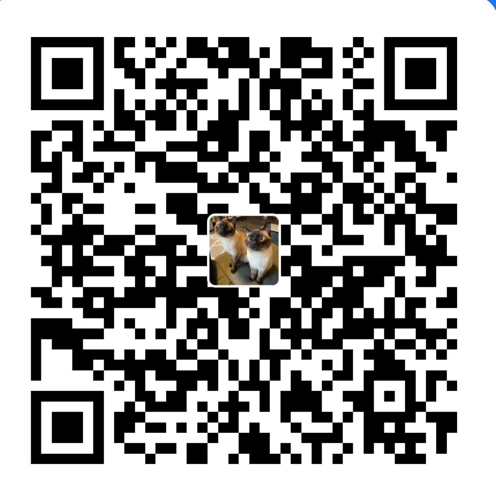

# Fangge Junshi · 防割军师

> **中文版: [README.md](README.md)**

An agent skill that decodes Chinese financial sales pitches and scam scripts — built by a former licensed investment advisor.

`v1.0.0` · Red-flag list last verified: **2026-10-13** (all 22 entries manually opened and confirmed reachable) · MIT License

**No stock picks. No return forecasts. No decisions made for you.** One job only: let you see the full picture *before* you hand over money.

---

## What is this

Fangge Junshi ("Anti-Scam Strategist") is an **Agent Skill** — a small set of Markdown files. Install it into Claude Code, Codex, Cursor or any tool that supports Agent Skills, and your AI gains an anti-scam strategist:

- You paste **a piece of text** into it — a wealth manager's pitch, an insurance agent's WeChat message, a stock-tip group announcement, a livestream sales script, a loan broker's offer, or a "pension project" a relative dragged you into —
- It tears the text apart through a **fixed workflow**: every sentence labeled as fact vs. claim vs. sales tactic, the other party's likely revenue model, a check against a **22-item red-flag list** (each flag cited to the original regulator notice), the key facts they *didn't* tell you, and a list of **questions you can copy-paste straight back at them**,
- Finally it tells you: which official systems to verify with, and exactly when to **walk away**.

It doesn't predict markets, recommend products, or make buy/sell decisions for you. It does one thing: **make sure you see what the person across the table is playing at — before your money moves.**

## Why this exists

I spent three years as a licensed investment advisor at a Chinese securities firm. How sales scripts are engineered, which lines regulators forbid, which "guaranteed returns" can never actually be written into a contract — frontline knowledge that ordinary investors rarely get to see.

Regulators (the CSRC and its regional bureaus, the National Financial Regulatory Administration, public security authorities) do publish risk warnings constantly — but they're scattered across dozens of official websites, and **nobody is going to dig through them in the moment they're being pitched**. This skill turns those scattered notices into a lookup table you can use on the spot: paste the pitch, get the red flags.

## What it does

| Module | Content |
|---|---|
| 🚨 Verdict first | How many red flags hit; if you've already transferred money, the first line is damage control (stop transfers, preserve evidence, call the police) |
| Scenario | Stock tips / wealth products / insurance / loans / illegal fundraising / fake police — six scenario types |
| Sentence-by-sentence breakdown | Each sentence labeled **fact / claim / sales tactic** (only independently verifiable evidence counts as fact — even a quoted price is just a claim) |
| How they make money | Commissions, group fees, pump-and-dump, virtual trading platforms eating your principal… understand the motive (marked as inference, never an accusation) |
| Red flags hit | 22 red flags, **each cited to the original official source with a last-verified date** |
| What they didn't tell you | The critical information gaps |
| Questions to ask them | Copy-paste-ready questions ("Please share your license number as listed by the Securities Association of China") |
| 🔎 Gap check | Which red flags for this scenario *haven't* appeared yet — an early warning of what they might say next |
| Verify & stop-loss | **Direct links** to official lookup systems; clear lines for when to stop immediately |

## What it will NOT do (iron rules)

1. **No stock picks, no product recommendations, no return forecasts, no buy/sell calls.** Ask "what should I buy" and it will point you to licensed institutions — after verifying their credentials.
2. **No fabricated evidence.** Every red flag must map to an entry in the red-flag list with its official source. No invented regulation numbers, cases, or figures.
3. **No "this is definitely a scam" verdicts.** It only says "highly consistent with the characteristics described in regulator notice ××" — judgment and reporting stay with you and law enforcement.
4. **Danger first.** On signs like "already transferred money / asked to install an unofficial app / asked to transfer to a personal or 'safe' account / asked to pay a fee to unlock withdrawals / caller claims to be police / asked to share your screen / someone offers to 'recover' your lost money after a scam" — the first paragraph is damage control, analysis comes after.

## Quick start

Works with Claude Code, Codex, Cursor, and other tools that support Agent Skills.

```bash
# Claude Code
git clone https://github.com/TTNAN/fangge-junshi ~/.claude/skills/fangge-junshi

# Codex
git clone https://github.com/TTNAN/fangge-junshi ~/.codex/skills/fangge-junshi
```

Then just tell your AI: *"Can you check whether this pitch is legit: …"* (paste the other party's script after it).

No agent tooling? Paste [`SKILL.md`](SKILL.md) plus the [`references/`](references/) folder into any LLM — it's plain-text prompting, zero dependencies.

## How it works (inside the skill)

1. **Locate the scenario**: stock tips / wealth products / insurance / loans / illegal fundraising / other (multiple allowed; the red-flag list opens with a scenario-to-flag map)
2. **Break down sentence by sentence**: fact / claim / sales tactic (manufactured scarcity, authority endorsement, social proof, sunk cost, emotional leverage…)
3. **Follow the money**: infer their revenue model against the incentive map in [`references/incentives.md`](references/incentives.md)
4. **Check the red-flag list**: compare against [`references/red-flags.md`](references/red-flags.md) one by one; for each hit, cite the flag number, the original quote, why it hits, and the official source
5. **Unknowns & questions**: turn what they didn't say into questions you can send them directly
6. **Verify & stop-loss**: 2–4 official verification actions (direct links from [`references/verify.md`](references/verify.md)) plus an explicit stop-loss line

## Red-flag list (22 flags, each with an official source)

Full list in [`references/red-flags.md`](references/red-flags.md) (Chinese), each with a last-verified date. Overview:

| # | Red flag | Source |
|---|---|---|
| R-01 | Promises of guaranteed principal/returns | National Financial Regulatory Administration |
| R-02 | Paid stock tips without a license | Sichuan CSRC Bureau |
| R-03 | Profit-sharing / "pay after you profit" | Guizhou CSRC Bureau |
| R-04 | Funneling from public platforms to private chats | Shenzhen / Jiangsu CSRC Bureaus |
| R-05 | Asked to install an unofficial / "VIP internal" app | Shenzhen CSRC Bureau |
| R-06 | Pushed from stocks into forex / crypto / spot (cross-product switching) | CSRC |
| R-07 | "Insider info" / market makers / high IPO lottery odds / pre-IPO shares | Shenzhen CSRC Bureau |
| R-08 | "AI / quant / big-data" stock-picking software | Sichuan CSRC Bureau |
| R-09 | Impersonating licensed-institution staff | Shenzhen CSRC Bureau |
| R-10 | Transfers to personal accounts / fees to "unlock" withdrawals | Shenzhen CSRC Bureau |
| R-11 | Off-exchange margin / high-leverage stock trading | Guizhou CSRC Bureau |
| R-12 | Selling insurance as deposits, wealth products or funds | National Financial Regulatory Administration |
| R-13 | Exaggerated returns or coverage / product confusion | *Measures for the Suitability Management of Financial Products* |
| R-14 | The three elements of illegal fundraising | *Regulation on Preventing and Handling Illegal Fundraising* |
| R-15 | Manufactured urgency / limited-time / "only N spots left" | National Financial Regulatory Administration |
| R-16 | Shill testimonials / free trial leading to expensive VIP upsell | CSRC |
| R-17 | Paid "credit repair" / "whitewashing" services | NFRA Hebei Bureau |
| R-18 | "Guaranteed approval" loans / upfront fees before disbursement | Beijing Financial Regulatory Bureau |
| R-19 | "Debt restructuring" / high-interest bridge loans / cut-interest tricks | NFRA Consumer Protection Bureau |
| R-20 | Only daily/monthly rates quoted / loans disguised as "installments" | National Financial Regulatory Administration |
| R-21 | Fake police/prosecutors / "safe accounts" / screen sharing | Public security authorities |
| R-22 | Fake "recovery" services / "we'll get your scammed money back" | Guizhou CSRC Bureau, NFRA |

## Example

> Input (fictional): *"Join the group and try three free stock picks. Upgrade to VIP if they're accurate — ¥9,800/year, insider institutional picks, 85%+ win rate. Full refund if you don't profit. Only 5 spots left today."*

```
🚨 Highly consistent with the illegal stock-tipping patterns described in regulator notices. 7 red flags hit. Don't pay yet.

🚩 R-02 Unlicensed paid stock tips  —— "VIP ¥9,800/year"        —— Sichuan CSRC Bureau
🚩 R-07 Insider info               —— "institutional insider picks" —— Shenzhen CSRC Bureau
🚩 R-15 Manufactured urgency       —— "Only 5 spots left"       —— NFRA
...
Questions you can send them:
1. Please share your license number as listed on the Securities Association of China's website — I'll verify it myself.
2. Which company receives the ¥9,800? Please share the corporate account and the service contract.
```

Full worked examples (Chinese):
- [Stock-tip group](examples/01-荐股群.md)
- ["Upgraded deposits" at a bank counter](examples/02-保险当存款.md)
- [Money in, withdrawals blocked](examples/03-外汇虚拟盘.md)
- ["Pension project" from a relative](examples/04-养老集资.md)
- [Loan broker's "guaranteed approval"](examples/05-贷款中介.md)

## Design principles

1. **Only cite what's checkable** — all 22 red flags come from CSRC bureaus, the NFRA, public security authorities, and State Council regulations, each with a last-verified date: [`references/red-flags.md`](references/red-flags.md)
2. **One click to verify** — direct links to official lookup systems (SAC practitioner registry, China Wealth Management website, financial license lookup, ICP filing): [`references/verify.md`](references/verify.md)
3. **Fact / claim / unknown** — only independently verifiable evidence counts as fact; even a quoted price is just a claim
4. **No scam verdicts** — only "consistent with the characteristics in regulator notice ××"; judgment stays with you
5. **Danger first** — already transferred money, asked for an "unlock fee", a "police" call, or someone offering to recover your losses: damage control before analysis
6. **Zero dependencies** — pure Markdown, no API keys, none of your data uploaded anywhere

## Contributing

Issues / PRs welcome:
- New scam scripts (please anonymize)
- Newly published regulator risk warnings (with official links)
- Scenario extensions: Hong Kong / US stocks, crypto
- Dead links or outdated notices (with a replacement official source)

## Changelog

- **v1.0.0 (2026-10-13)**: First stable release. 22 red flags, each cited to its official source and manually verified reachable; 5 full worked examples (stock-tip groups, insurance-sold-as-deposits, blocked forex withdrawals, pension fundraising, loan brokers); direct links to all official verification channels; a "gap check" output row that warns about red flags this scenario might trigger next.

## Disclaimer

This project is for identifying common financial-risk patterns and investor education only. It is not investment advice, nor a legal determination against any person or institution. If you suspect fraud, call the police (110 in mainland China) or the anti-fraud hotline 96110.

## Buy me a coffee ☕

If this skill saved you from a trap, you're welcome to buy me a coffee:

| Alipay | WeChat Pay |
|---|---|
|  |  |

## License

MIT
